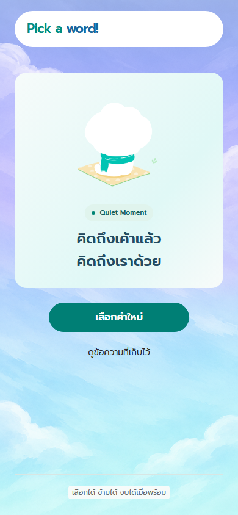
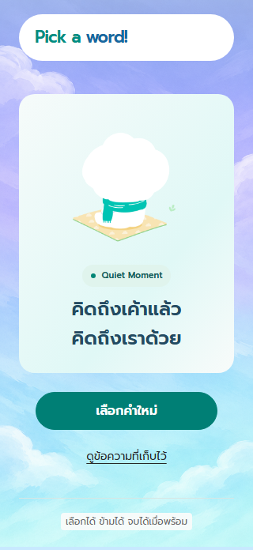
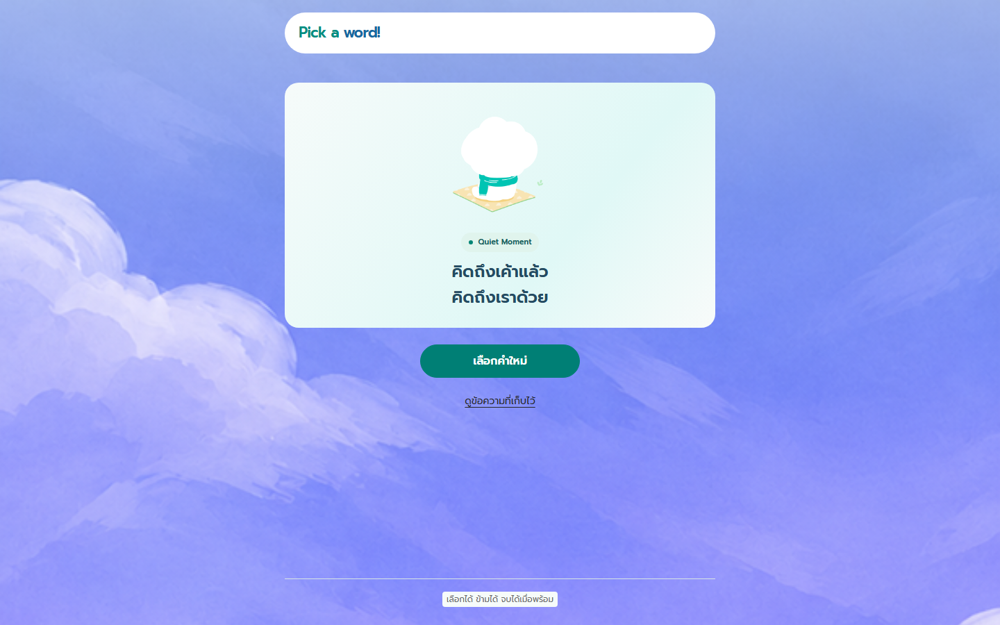

# Restore Done after saving

Previously, a successful save in Write returned directly to Discover. The flow now shows the Figma Done screen first. “เลือกคำใหม่” resumes the same card, cursor and deck; “ดูข้อความที่เก็บไว้” opens History, whose Back button returns to Done.

## Design and implementation

- Reference: [Figma 05 Done, 6034:6262](https://www.figma.com/design/zi16QrXxTPXniyh9garjI6/?node-id=6034-6262), 390 × 844.2.
- `DoneScreen.tsx` presents Quiet Moment, “คิดถึงเค้าแล้ว / คิดถึงเราด้วย”, the two actions and the existing reassurance footer. The header reuses `BrandHeader` with its history action hidden on Done.
- Sky and Quiet Moment use the existing local PNGs. Both are byte-identical to the assets returned by Figma for this screen. The 6 × 6 status dot is a direct, unmodified Figma SVG export. See [asset provenance](assets/done-figma-source.json).
- The primary button retains the shared dark teal/white colors approved in PR #2. Its placement and size follow the Done frame; the other screens retain their existing styles.
- The small footer text has a scoped light backing. The original transparent footer fell to roughly 1.9–2.1:1 on the desktop sky crop; the opaque backing makes its text contrast independent of the background image.
- Saving still writes only quote snapshot, focus and metadata. The private draft clears only after successful storage; storage failure or a full daily quota stays on Write with the draft intact. Done/History navigation does not save again.

## Visual verification

At 390 × 844, the header is at (24, 18), the card at (24, 118.64) with size 342 × 353, artwork at (105, 142.64) with size 180 × 180, and the primary action at (80, 495.64) with size 230 × 48. The footer starts at y = 777.20. These match the Figma layout within subpixel rendering differences.

The 320 × 568 layout scrolls naturally without horizontal overflow. The 1440 × 900 layout uses the existing centered reading width. Heading focus moves to Done after a successful save.

## Verification scope

The new regression first failed because `.screen-done` was absent, then passed after implementation. Automated coverage checks draft privacy, save failures, daily quota, repeated selections, history navigation, deck continuity and responsive keyboard use. F04 and button-contrast coverage include Done. Final test results are recorded in the pull request and its CI run.

Native share and Google Calendar integration tests continue to use mocks; this change does not claim new real-account or device-share verification.
