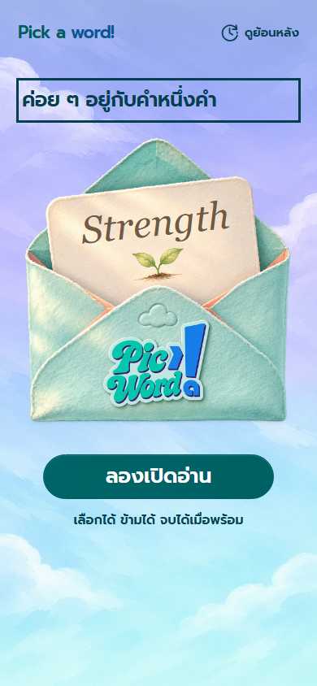
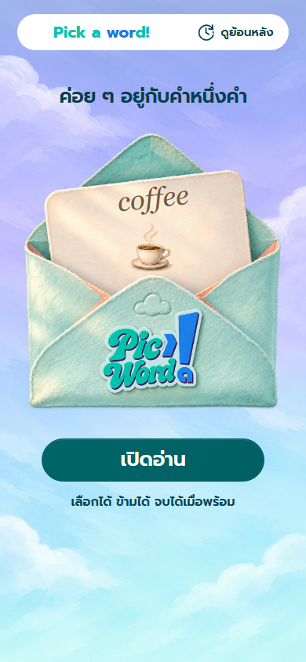
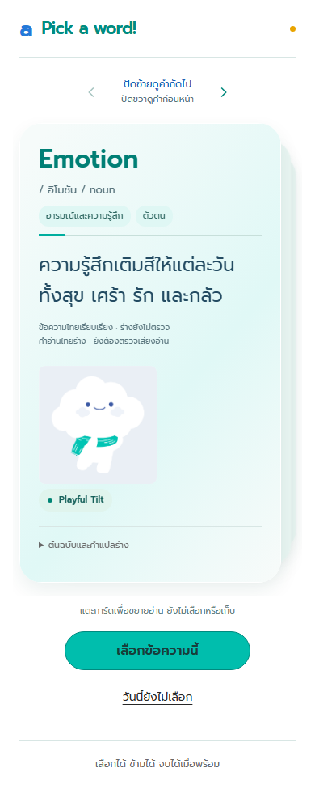
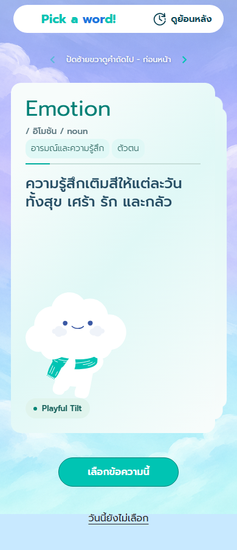
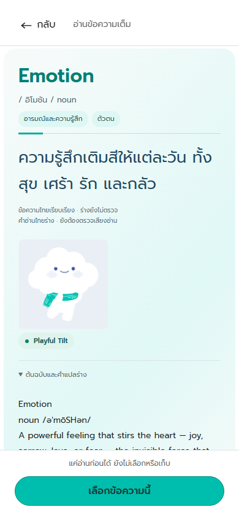
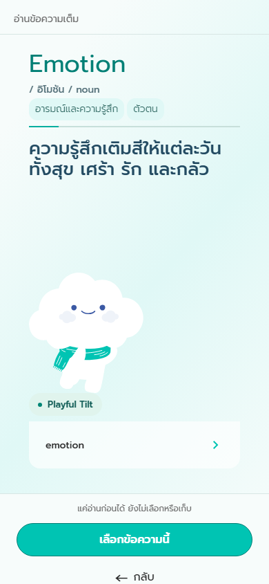
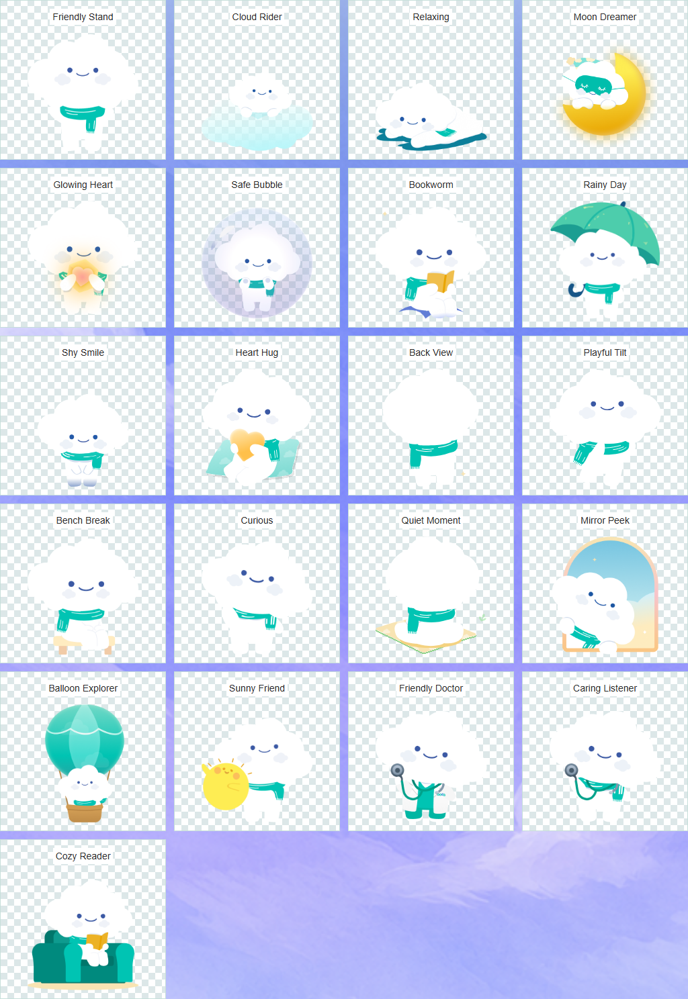
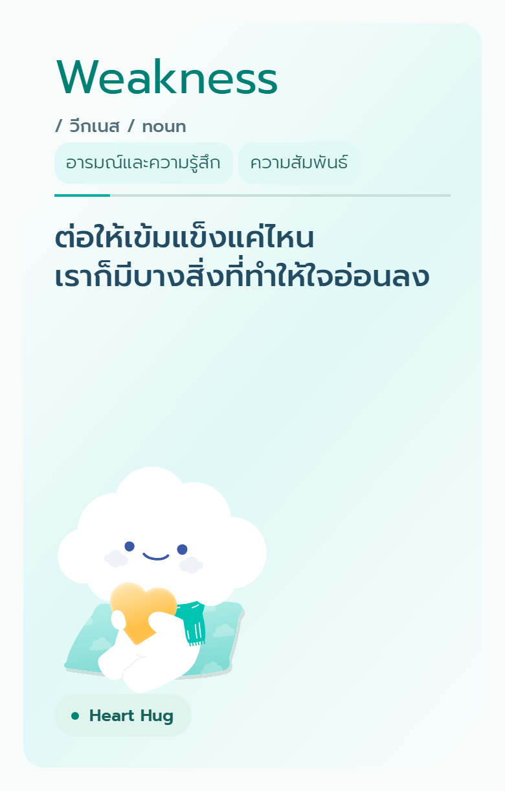

# Pick a Word — verification and review, 2026-11-10

Review: [PR #1](https://github.com/Vagueslim/OOCATest/pull/1). The current complete-suite result is the `validate` check on the latest PR head: [CI results](https://github.com/Vagueslim/OOCATest/pull/1/checks). This document records scoped checks completed during assembly; the PR description records the final local full-suite result. A green earlier commit is not sufficient for merge.

## Scope and commit sequence

Baseline: `7db818fce71bb2c220697bbd71edab0ad4f699bc`. Source: the owner's reviewed local React demo. Existing release checkouts and their pending changes were preserved. Only meaningful changes were ported; unchanged files and line-ending-only differences were omitted.

| Step | Commit | Change and verified boundary |
|---|---|---|
| 1 | `cdd0266` — ci: validate pull requests | Node 24 CI, PR template, ignore rules and screenshot directory setup; production build passed |
| 2 | `8576d5c` — feat(content): update draft pronunciations | 37 explicit before/after updates; 2 data tests passed; build passed |
| 3 | `74988f0` — feat(ui): align Pick a Word flow with Figma | 19 Figma/preview/layout tests passed; build passed |
| 4 | `1e9d407` — feat(share): export and share quote cards | 11 sharing tests passed; build passed; one html-to-image dependency added |
| 5 | `44f28fe` — fix(artwork): normalize transparent mascots | 20 targeted cases passed across artwork/Mooca/sharing; build passed |
| 6 | docs: document workflow and verification | This report, current README, workflow, reading table and selected review images |
| 7 | fix(test): preserve raw catalog casing in snapshot checks | Follow-up from CI: deterministic lowercase regression and exact persisted headword check |

The existing Swiper EffectCards implementation already matched the approved demo. Its behavior is retained and regression-tested; there is no artificial code-only commit claiming to restore an implementation that was already on main.

## Data and behavior checks

- Catalog: exactly 107 stable IDs. The 37-update fixture restores only approved `reading`/`readingKind` fields and compares the canonical SHA-256 of the complete restored catalog to main. This protects text, IDs, visibility and all other fields. The original historical 53-record fixture remains unchanged. See [before/after readings](pronunciation-updates.md).
- Save: only the quote snapshot and optional focus persist; typed text stays transient. Successful save returns to the same browsing deck. Failed saves retain the current draft and show an error. Existing snapshots remain the source of truth in history.
- Preview: one natural scroll surface, collapsed source details initially, actions at the bottom, keyboard focus/Escape behavior retained.
- Sharing: public card DOM only; PNG prepared before the activation click. Tests cover cancellation, duplicate attempts, stale preparation, unsupported/error fallback, privacy and touch activation. Cancel does not automatically download.
- Artwork: actual canvas alpha bounds match all 21 source assets. Aspect ratio, centering, bottom alignment and the 166 × 176 slot pass at 320, 390 and 1440px. Original source asset bytes remain intact; native SVGs retain their exporter whitespace and provenance hashes.
- Export: PNG generation exercised for Playful Tilt, Back View, Quiet Moment, Heart Hug, Caring Listener and long text. The two additional mascot exports are 780 × 1222 pixels and were visually inspected.
- Favicon: SHA-256 matches the supplied glyph-a.svg exactly. Production output references `/OOCATest/favicon.svg`.

One scoped 107-card traversal was interrupted by Vite reloading after a source comment changed during test preparation. With source frozen, that exact traversal passed on rerun. The final full suite runs with source frozen.

## CI follow-up

The full local suite at 8b7f72c passed 158/158 (no skips or flaky cases). CI then exposed a randomized test assumption: innerText returned the CSS-capitalized Family while the correctly persisted catalog headword was family. A separate seventh commit preserves that audit trail instead of rewriting the six planned commits. The regression now deterministically selects the lowercase family card, reads raw textContent and checks the exact first saved line. It passed three consecutive focused runs. Application behavior and catalog data are unchanged; the latest-head CI reruns all 158 cases.

## Final verification procedure

```sh
npm ci
npm run build
npx playwright install chromium
npx playwright test --config=playwright.config.ts
```

The completed implementation discovers 158 tests. The normal config starts Vite on 5181; no test is intentionally filtered out for CI. CI uses Node 24 and Chromium on Ubuntu; local checks used Node 26.13.0 and Playwright Chromium on Windows. The PR must have a green latest-head check before review completion/merge. Failure reports, traces and screenshots are retained by Actions for 14 days.

A separate production-build smoke check on `/OOCATest/` passed: load, next/previous, collapsed preview, save back to Discover, private draft exclusion, history and SVG favicon. No runtime errors were observed. This was a local production preview, not a deployment to the public site.

## Before and after

Before images were captured from an archive of exact main commit `7db818f`; after images use the final code at `44f28fe`. Both use Chromium, 390 × 844 viewport, reduced motion and the same deterministic deck; the shown card is `catalog-v1:ooca-050` (Emotion). Welcome/Discover images show full page content; preview images show the viewport.

| Screen | Before | After |
|---|---|---|
| Welcome |  |  |
| Discover |  |  |
| Preview |  |  |

All 21 normalized poses on a checkerboard (transparent areas remain visible):



Example exported PNG, containing only public card content:



## Limits and release handoff

Native share and Google Calendar responses are mocked in automated tests. No actual recipient was contacted, OAuth grant created, or Calendar event created. Device/browser share-sheet behavior still needs a real-device check. Chromium touch emulation does not establish Safari/iOS coverage. Language content remains draft; changing readings is not language approval or clinical validation.

Main protection was configured and verified through the authenticated administrative API: PR required, latest `validate` check from GitHub Actions, up-to-date branch, resolved conversations, admin enforcement, no force push/deletion and zero required external approvals. Merge commits remain permitted. The GitHub integration lacked administration access; the authenticated CLI supplied that capability.

The owner reviews and selects **Create a merge commit**. Pages deployment remains the existing main-push workflow. Live-site verification, deletion of the merged feature branch, and worktree cleanup happen after that merge and successful deployment. See [workflow and revert instructions](../GIT_WORKFLOW.md).
