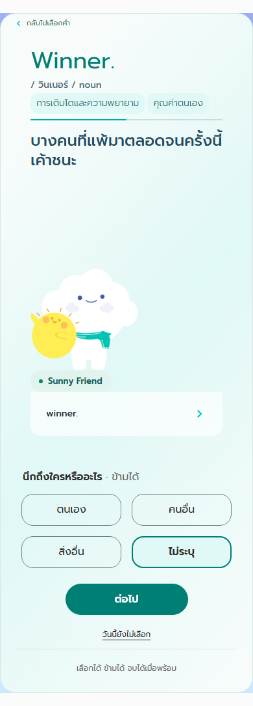
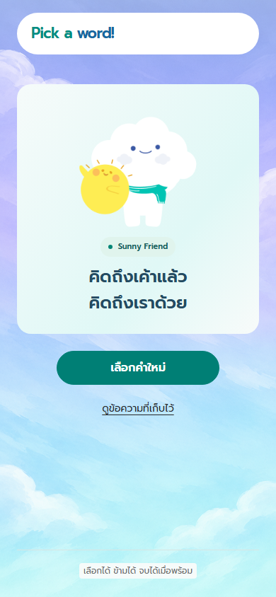
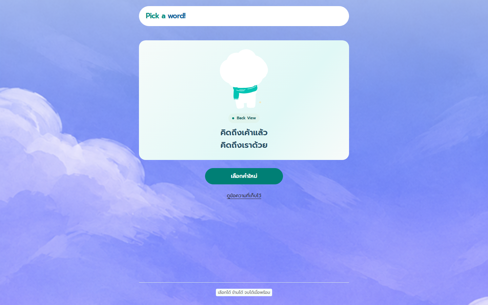

# Keep the selected Mooca on Done

Previously Done always displayed Quiet Moment, even when the selected card used another pose. Done now keeps the selected card's Mooca image and pose name after a successful save. This follows the user's correction to the earlier [Done screen reference](done-screen-2026-11-11.md).

The completed character stays in React state while visiting History and returning to Done. A later successful save replaces it with that card's character. A failed save stays on Write. Character data is not added to saved history; private drafts are still not persisted. A card without character metadata retains Quiet Moment as a fallback.

Done reuses `CharacterArtwork` and its visible-art bounds, so PNG and native SVG poses use the same 166 × 176 artwork slot as the cards. Its surrounding layout remains centered with the existing buttons and closing text. No assets, catalog mappings, daily quota or storage schema change.

## Visual evidence

Selected Sunny Friend at 390px:

After saving the same card:

Back View on a desktop viewport:

## Verification

The regression first reproduced Sunny Friend incorrectly becoming Quiet Moment, then passed after the change. Coverage follows three consecutive selections (Sunny Friend, Back View and Quiet Moment), verifies the same image URL and label through History, checks normalized size and preserves snapshot/draft-privacy assertions. Existing shared-artwork checks cover all 21 poses. Production-preview checks exercise these three poses at 320, 390 and 1440px with screenshots and overflow checks. Final suite, CI and deployment results are recorded in the pull request.
